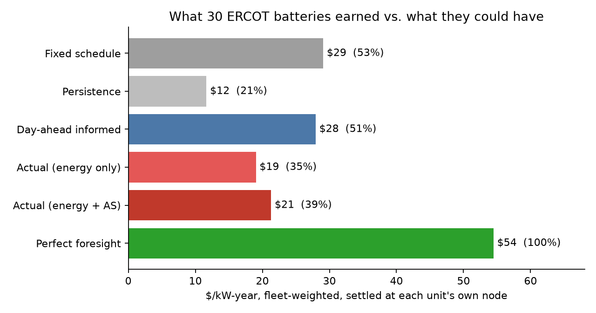
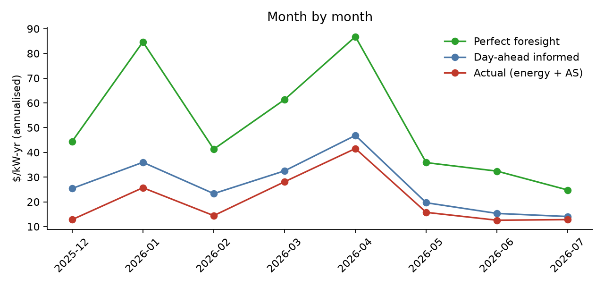
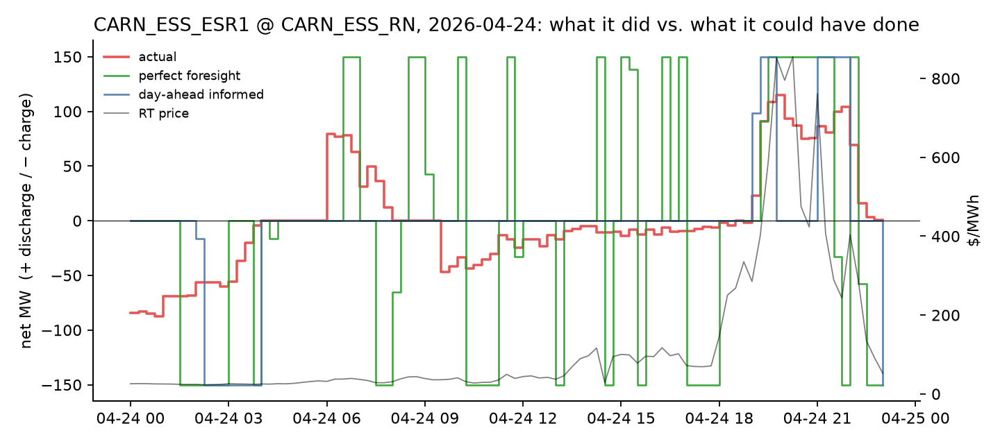
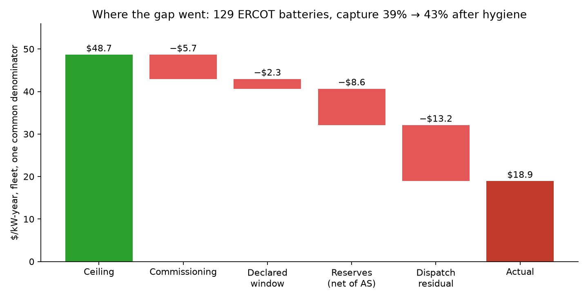

# How much money are Texas batteries leaving on the table?

*A battery arbitrage optimiser, benchmarked against what 30 real ERCOT
batteries actually did.*

---

## The question

Every battery-arbitrage tutorial does the same thing: take a price series,
write a linear programme, report the revenue. It is a fine exercise and it
tells you nothing, because there is no answer key.

ERCOT publishes one. Sixty days after the fact, its SCED disclosure reports
every storage unit's dispatch instruction and state of charge at five-minute
resolution. Join that to the price at the unit's own node and you can ask a
much better question than "what would an optimiser earn?" — namely:

> **What did real batteries earn, what could they have earned, and what
> explains the gap?**

This write-up builds the optimiser, runs it at each real unit's own price
node, and compares five dispatch strategies against the unit's actual
behaviour over seven months (Dec 2025 – Jul 2026), which is every day of
storage telemetry ERCOT has published since batteries got their own
disclosure at the RTC+B market redesign.

---

## The data

All from ERCOT's public API, via the pipeline in `scripts/`:

| Dataset | Used for |
|---|---|
| `sced_esr` | each unit's physical limits, opening SOC every day, and what it actually did |
| `settlement_point_prices` | the real-time price at the unit's own node, 15-min — what every strategy settles at |
| `dam_settlement_point_prices` | day-ahead prices — what a real operator knows the night before |
| `rt_as_prices` (np6-331-cd) | real-time ancillary-service clearing prices, so the real unit's reserve revenue can be counted |
| `crosswalk/` | unit → price node |

Physical parameters are read from telemetry rather than a registry: the
largest observed `HSL` is the discharge limit, the most negative `LSL` the
charge limit, `Max SOC` the usable energy. Round-trip efficiency is **82%**,
measured from the fleet's own charge and discharge totals — not assumed.

Units are included if they have a node link and were active (|Base Point|
> 1 MW) on at least 120 of the 207 days. That leaves 129; the benchmark uses
the 30 largest by energy capacity.

---

## The model

A battery over one day of `n` settlement intervals, each `Δt = 0.25` h.

**Decide**, for every interval `t`:
- `c_t ≥ 0` — charging power, MW
- `d_t ≥ 0` — discharging power, MW
- `s_t` — state of charge at the end of the interval, MWh
- `y_t ∈ {0, 1}` — mode: 1 if discharging is permitted, 0 if charging is

**Maximise** revenue net of any degradation charge:

```
    Σ_t  Δt · p_t · (d_t − c_t)   −   c_deg · Δt · (c_t + d_t) / 2
```

**Subject to**

| | Constraint | Meaning |
|---|---|---|
| SOC balance | `s_t = s_{t−1} + η_c·Δt·c_t − Δt·d_t / η_d` | energy in, less losses, less energy out |
| SOC window | `S_min ≤ s_t ≤ S_max` | stay inside the usable range the operator declares |
| Power limits | `c_t ≤ P_chg`, `d_t ≤ P_dis` | the inverter's rating |
| One mode at a time | `c_t ≤ P_chg·(1 − y_t)`, `d_t ≤ P_dis·y_t` | can't charge and discharge together |
| End where you began | `s_n ≥ s_0` | no "free" energy from draining the battery |
| Cycle cap (optional) | `Σ_t Δt·d_t ≤ N_cyc · (S_max − S_min)` | warranty-style throughput limit |

Efficiency is split symmetrically: `η_c = η_d = √0.82 ≈ 0.906`.

Implemented in Pyomo (`optimization/model.py`), solved with HiGHS. Prices and
the opening SOC are *mutable parameters*, so one model per unit is built
once and re-solved every day — about 60 MILP solves per second.

### Why the binaries matter here and not in the textbook

The usual shortcut is to drop `y_t`. The argument: with round-trip efficiency
below 100%, charging and discharging at the same moment only wastes energy,
so an LP optimum would never choose it.

**That argument is correct when prices are non-negative, and wrong in ERCOT.**
About 7% of ERCOT settlement intervals clear *below zero* — the grid pays you
to consume. When the battery is already full during such an interval, the
LP relaxation finds a trick: charge and discharge simultaneously, so the
round-trip loss "burns" stored energy and makes room to absorb more paid
charging. It is a genuine arbitrage on paper and physically impossible for an
inverter.

`tests/test_model.py` demonstrates both halves: the LP exploiting negative
prices (up to 14 MW of simultaneous charge and discharge on synthetic days),
the MILP refusing to, and the two agreeing to the cent whenever prices are
non-negative. The `--lp` flag on the benchmark sizes the effect on real
prices — see Results.

---

## The five strategies

Every strategy is settled at the unit's **own real-time node price**. They
differ only in what they knew when they decided.

| Strategy | Knows | Represents |
|---|---|---|
| **Fixed schedule** | nothing | charge 10:00–15:00, discharge 18:00–21:00, every day. What anyone could write. |
| **Persistence** | yesterday's real-time prices | optimise on them, run it today. The laziest forecast. |
| **Day-ahead informed** | today's day-ahead prices | optimise on them, settle real-time. **What a real operator can actually do.** |
| **Perfect foresight** | today's real-time prices | optimise on them. The upper bound — unattainable, but the yardstick. |
| **Actual** | — | what the unit did, from telemetry. Energy revenue, plus ancillary-service revenue (awards × clearing price). |

Three gaps carry the story:

- **Perfect foresight − Day-ahead informed** = the value of a perfect
  real-time forecast, in dollars.
- **Actual ÷ Perfect foresight** = the *capture rate*, the industry's
  standard measure of operator performance.
- **Actual with AS − Actual energy-only** = how much of the "gap" was never
  a gap: capacity held for reserves is capacity that is being paid.

### Fairness

Each day the optimiser starts from the SOC the real battery actually had at
midnight, not from empty. Days with missing intervals (DST changes, ERCOT
publication gaps) are dropped rather than patched. Persistence needs a prior
day, so it skips the first day of each run.

---

## Results

> **Read this first (2026-09-23).** The tables in this section are the
> original 30-unit run and include commissioning (`ONTEST`) unit-days; the
> sensitivities below were run on that set and are kept consistent with it.
> Two things changed after it was written. (1) Filtering to fully-ON
> unit-days, as any published benchmark does, moves the 30-unit capture rate
> from 39% to **45%**. The fleet-wide, status-filtered headline — 129 units,
> 42.5% — and the decomposition of the remaining gap are in
> **[`results/anatomy.md`](results/anatomy.md)**, which is what the README
> now leads with. (2) Finding #5 was wrong and is rewritten below.

### Headline — 30 units, Dec 2025 – Jul 2026 (all unit-days)

<p align="center"></p>

| Strategy | $/kW-yr (median unit) | $/kW-yr (fleet) | Capture vs perfect |
|---|---|---|---|
| Fixed schedule | 30.7 | 29.1 | 53% |
| Persistence | 11.5 | 11.7 | 21% |
| Day-ahead informed | 28.1 | 27.9 | 51% |
| Actual (energy only) | 18.6 | 19.0 | 35% |
| **Actual (energy + AS)** | **20.9** | **21.3** | **39%** |
| Perfect foresight | 53.3 | 54.5 | 100% |

*30 units · 199 days · 5,970 unit-days · every strategy settled at the unit's
own real-time node · each day opens at the unit's real SOC.*

- **Value of perfect foresight over day-ahead dispatch: $26.5/kW-yr** — 49% of
  the ceiling.
- **Ancillary services were 11% of what real units earned.** Real-time AS
  clearing prices averaged well under $1/MW-h across the window.
- **Capture across units: median 41%, IQR 33–46%, range 4–70%.**

### Sensitivities

| Variant | Perfect-foresight $/kW-yr | Change |
|---|---|---|
| Base (MILP) | 54.5 | — |
| LP relaxation | 54.6 | +0.2% — but see below |
| $10/MWh degradation cost | 51.3 | −5.9% |
| 1.5 cycles/day cap | 52.6 | −3.5% |

### Reading the results

**1. Real batteries captured about two-fifths of what was available.**
$21/kW-yr against a $54 ceiling. The best unit (SHAMROCK, 100 MW / 3.3 h)
captured 70%; two others cleared 60%. So 60–70% is achievable — the fleet
median of 41% is an operating outcome, not a physical limit.

**2. The dumb strategy beat the smart one.** Charging at noon and discharging
at dinner, every day, with no price information at all, earned $29/kW-yr —
*more* than optimising against the day-ahead price ($28). This held across
the full seven months, not just one lucky one. ERCOT's evening peak is so
reliable that a schedule tuned to the market's shape catches it; optimising
against day-ahead prices commits to day-ahead peaks that real-time doesn't
always honour (the average |DA − RT| gap is $11–13/MWh). The lesson is not
that optimisation fails — perfect foresight nearly doubles both — but that
**an optimiser fed the wrong price series can lose to a heuristic that
encodes the right shape.**

**3. Yesterday is a bad forecast.** Persistence captured 21%. Real-time
spikes don't repeat on schedule.

**4. The money is in a handful of days.** January and April each delivered
$85–87/kW-yr annualised under perfect foresight; June and July under $35.
Monthly capture rose from 29–30% in Dec–Jan to 44–52% by May–Jul — partly
operators settling in after the RTC+B redesign, partly fewer spikes to miss.

<p align="center"></p>

**5. The "worst days" were mostly not what they looked like.** The first
version of this write-up led with 21 January and 17 February as "the two
biggest scarcity events of the winter", during which four units charged into
$3,000 prices. That was wrong in two ways, both caught by checking the
telemetry status column and the shadow prices. The hub averaged $23–60 on
those days: the spikes were nodal, on two violated 138 kV constraints
(`138_NAL_HAS_1` on Jan 21, `BLASCOFE_RC_1` on Feb 17, both at the $3,500
cap). And the two Jan 21 units were commissioning — EVLN 100% `ONTEST`, WZRD
86% — running test schedules, not trading. The TANZ pair on Feb 17 was mostly
ON (82%) and did charge ~400 MWh each into the spike; that is a real event,
but a local-constraint one, and whether their own charging loaded the line
cannot be established from public data.

The true worst days for units that were fully operational are different, and
cluster on **Winter Storm Fern, 24–27 January**:

| Unit | Day | Actual | Perfect foresight |
|---|---|---|---|
| JAG_SLR_ESR1 | 2026-01-25 | **−$60,417** | +$98,990 |
| ANOL_ESS_ESR1 | 2026-02-01 | −$59,161 | +$59,324 |
| BLACKSPR_ESR1 | 2026-05-18 | −$56,470 | +$150,674 |
| EBNY_ESS_ESR1 | 2026-01-26 | −$55,619 | +$161,110 |

And the sequel to "the money is in a handful of days" is that the *shortfall*
is not: across the fleet, the 20 biggest perfect-foresight days carry 40% of
the ceiling and 40% of the dispatch residual, and capture on those days (44%)
was slightly *higher* than on the other 179 (42%). Dollar concentration is
real; operating failure on spike days is not the story. See
`results/anatomy.md` §5.

<p align="center"></p>

**6. The LP shortcut: wrong in principle, cheap in practice — for now.** On
real prices the relaxation over-claimed perfect-foresight revenue at **29 of
30 units** — by $7,300 at the median unit and $50,700 at the worst over the
window, $3,900 on the single worst day — yet only +0.2% fleet-wide. The
mechanism is real and the binaries are cheap (60 solves/s), so there is no
reason to accept it. But its size scales with how deep and how often prices
go negative, and both are rising with every gigawatt of solar. A model built
on the shortcut will drift wrong quietly.

**7. The ceiling survives realistic wear limits — so caution doesn't explain
the gap.** Unconstrained perfect foresight cycles a battery **2.0 times a day**
(90th percentile 2.7); the real units averaged **0.7** (90th percentile 1.2).
That looks like the optimiser buying revenue with degradation an operator
would never accept. But cap it at a warranty-style 1.5 cycles/day and it
still earns 96.5% of the ceiling; charge it $10/MWh of throughput and it
keeps 94%. The extra cycling is shallow micro-arbitrage on small ripples
(visible in the example-day chart) that adds little. **The 39% capture rate
is an operating outcome, not the price of protecting the asset.**

**8. Reserves added 11% to measured revenue — but that is a floor, not the
AS story.** Real-time reserve clearing prices averaged under $1/MW-h across
this window, which is consistent with the widely reported saturation of
ERCOT's AS market by storage. It would be wrong to conclude from this number
that reserves no longer matter, because **this benchmark only prices
real-time awards.** ERCOT procures most of its ancillary services day-ahead,
and DAM MCPC typically clears several times higher; those awards need the
60-day DAM ESR disclosure (`/np3-966-er/60d_dam_esr_data`), which this project
has not yet pulled. Real units also sell energy day-ahead, whereas every
strategy here — actual included — is settled entirely at real-time prices.

So read the headline as **energy-arbitrage capture, with a partial reserve
credit**, not as total revenue capture. The direction of the bias is known:
counting the day-ahead stack would raise "actual" and narrow the gap. What
the comparison does support is the narrower claim it was built for — that
against a *price-taking, energy-only ceiling at each unit's own node*, real
dispatch captured about two-fifths, and that the shortfall is an operating
outcome rather than the price of protecting the asset (finding 7), with the
pieces named in finding 9.

**9. Where the gap actually went.** Decomposing the ceiling-to-actual gap
for all 129 active units (`results/anatomy.md`): **12%** of the ceiling sat
on unit-days the unit was not fully ON; **5%** is the SOC window operators
declared; **18%** is reserves held, net of the AS revenue they earned at
real-time prices — holding the unit's awards cost 26 points of ON-day energy
revenue and earned back 5, and not one unit's reserves paid for themselves at
real-time MCPC; and **27%** is dispatch. On a further quarter of the ceiling
the unit's own offer set the LMP, so a price-taking ceiling is not credible
there at all. The reserves figure is an upper bound — real-time awards are
co-optimised outputs rather than prior obligations, and day-ahead awards at
DAM MCPC would earn more — and the dispatch residual is spread evenly across
ordinary days rather than concentrated on the big ones. Finding 8 stands as a
statement about what units *earned*; the anatomy says reserves are a large
share of what they *gave up*, at least at real-time prices.

<p align="center"></p>

---

## What this does not capture

Being explicit, because the gaps are where the next version lives:

1. **AS revenue is counted for the real unit but not optimised for.** The
   optimiser only trades energy. A co-optimising model that chooses between
   energy and reserves each interval is the obvious next step, and post-RTC
   it is the model ERCOT itself runs. AS revenue is also priced at real-time
   MCPC only; day-ahead awards are paid at DAM MCPC, typically 2–4× higher,
   which needs the DAM ESR disclosure.
2. **Perfect foresight is a yardstick, not a strategy.** Nobody has it. The
   realistic ceiling is somewhere between day-ahead-informed and perfect, and
   the distance between them measures what better price forecasting is worth.
3. **Efficiency is a fleet average.** Individual units differ; a unit with
   88% round trip looks worse than it is against an 82% optimiser.
4. **Degradation is a flat throughput charge**, not a depth-of-discharge or
   temperature model.
5. **Unit limits are observed maxima.** A unit that never ran flat out
   appears smaller than its nameplate.
6. **Seven months, one market regime.** Every day here is post-RTC+B; there
   is no pre-RTC storage disclosure to compare against.

---

## Reproduce it

```bash
pip install -r requirements.txt
python optimization/fetch_as_prices.py          # ancillary-service prices (~2 min)
python -m optimization.benchmark --units 30     # ~15 min
python -m optimization.benchmark --units 30 --lp --tag lp
python -m optimization.benchmark --all --tag fleet    # every unit, ~4.5 h
python -m optimization.price_setting --tag fleet      # offer-curve flags, ~4 min
python -m optimization.anatomy --tag fleet            # the waterfall
pytest                                          # 27 tests, no data needed
```

Results land in `optimization/results/`. Every number in this write-up comes
from `summary_*.csv`; per-unit-per-day detail is in `unit_day_*.parquet`.
